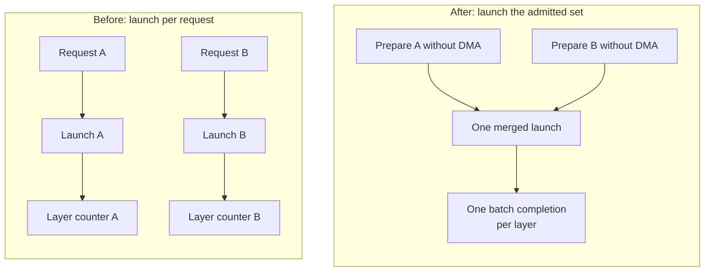

# FlexKV integration

SGLang delegates host, SSD, and remote KV transfers to the external
[FlexKV package](https://github.com/taco-project/FlexKV). Ordinary models use
`FlexKVRadixCache(RadixCache)`. DeepSeek V4's split C4/C128/SWA layout uses
`FlexKVHybridRadixCache`, which wraps `UnifiedRadixCache(FULL, SWA)` and leaves
radix insertion, SWA state, and eviction accounting with the inner cache.

## Setup

Install compatible SGLang and FlexKV source revisions, including their required
kernel and native extensions. The FlexKV package must provide
`flexkv.integration.sglang.connector.FlexKVConnector` and
`FlexKVHostReleaseShim`. There is no connector or communication-layer copy in
this directory. Use the package's build instructions and the kernel version
required by your SGLang checkout.

Start with the [example configuration](example_config_mp.yaml), adjusting the
CPU pool to the host's available memory:

```bash
python3 -m sglang.launch_server \
  --model-path /path/to/model \
  --enable-flexkv \
  --flexkv-config-file /path/to/flexkv_config.yaml
```

`--radix-cache-backend=flexkv` also selects this backend, including prefetch and
periodic completion polling. Both forms honor `--flexkv-config-file` when
`FLEXKV_CONFIG_PATH` is unset. An existing `FLEXKV_CONFIG_PATH` takes precedence.

## Restore ownership

Both transfer modes perform a lookup in `match_prefix` and defer GPU allocation
and retrieval until scheduler admission has passed:

- **MP, synchronous default:** `retrieve_kv` waits for completion. The ordinary
  radix adapter publishes restored slots to the tree. A short result remains
  cached but is reported as an admission miss so recomputation is budgeted.
- **IP, `FLEXKV_ENABLE_LAYERWISE_TRANSFER=1`:** the adapter registers ownership
  before starting H2D. Per-layer transfer counters fence consumption during
  forward. Fresh slots remain request-owned until normal cache completion.
- **Hybrid:** both MP and IP restore into request-owned slots. Normal completion
  inserts them through the inner unified cache, preserving SWA semantics.

`flexkv_cache_lifecycle.py` contains the shared request identity, restore ledger,
lease validation, and prefetch methods. Every tracking key includes
`(rid, attempt_id)`, so stale cancellation cannot cancel a retry. Waiting-queue
and priority rematches preserve uncommitted restore slots. Reset fences the
connector before reclaiming allocations from the ledger, even when request
metadata is stale; failed frees retain their ledger entries.

An unexpected positive partial layerwise result is a connector contract
violation. Its count does not prove any destination is idle, so the adapter
retains ownership and raises instead of freeing a potentially active DMA tail.
This is not automatic request-level recovery.

## Optional batching after admission

This branch adds the SGLang half of
[FlexKV #323](https://github.com/taco-project/FlexKV/pull/323), reviewed in
[SGLang companion #17](https://github.com/XingLiu1/sglang/pull/17). Install both
matching implementations. It applies to the ordinary IP adapter; MP and hybrid
adapters retain their current launch path.

Without batching, each admitted request starts its own layerwise transfer.
With batching enabled, `init_load_back` prepares the request's mappings and
completion counter without submitting DMA. Once `can_run_list` is final, the
scheduler flushes those members together, before forward-batch setup:



The two requests illustrate launch coalescing, not measured timing. Lookup,
mappings and preflight remain per request. The final launch and completion
accounting are merged; forward still waits for each layer to become ready.
Each rank retains its own layer wait/notification for the merged task.

Enable it with:

```bash
export FLEXKV_ENABLE_LAYERWISE_TRANSFER=1
export FLEXKV_BATCH_LAYERWISE_RESTORE=1
# Use the normal --enable-flexkv launch command above.
```

`FLEXKV_BATCH_LAYERWISE_RESTORE` defaults to `0`. A connector without
`flush_layerwise_loads` keeps immediate launch even when the flag is set.
`launch_pending_loads(can_run_list)` preserves the complete `(rid, attempt_id)`
identity and flushes once after admission. The connector validates the same
members on all ranks and coalesces them into one task with one signal per layer.

The allocation-readiness vote is a correctness fix for connectors that provide
`sync_load_ready`, including when batching is off. If any rank cannot allocate,
successful peers free their new slots and release the held lookup; reusable GPU
prefix slots stay owned by the cache. Older connectors retain the local check.

Prepared requests can be cancelled before launch. After an unacknowledged
launch, mappings remain owned and reset/reclamation is rejected until safety
can be established. CE H2D/D2H selection is independent of admission batching;
its switches and native rebuild requirement are documented in FlexKV's
[illustrated cache restore guide](https://github.com/taco-project/FlexKV/blob/cd6ce5ebbd52da72e62992592637a8833c9d953b/docs/cache_tier_performance_controls.md)
and [中文图解](https://github.com/taco-project/FlexKV/blob/cd6ce5ebbd52da72e62992592637a8833c9d953b/docs/cache_restore_optimizations_zh.md).

The focused CPU tests verify launch order, retry identity, capability fallback
and allocation rollback with mocked transfers. Per-layer waits or cache hits
alone do not establish model-output correctness or end-to-end performance.

## Store ownership

A store retains the source radix node until the connector reports completion.
Aborting its request does not release a staged or launched store's source lock.
Only a store that has not started GPU work can be cancelled immediately.

For the ordinary adapter, the connector's `supports_async_store_slot_mapping`
capability selects deferred GPU-to-pinned-CPU mapping copies. Hybrid SWA keeps
synchronous mapping because its GPU-side FULL-to-SWA translation has no async
sideband. Both ready-store and completed-store collectives run from the
rank-symmetric `check_hicache_events` hook; local-pressure `evict` never polls
these collectives. `release_host_resources` drains and shuts down the connector.

Hybrid stores capture page-aligned SWA/compress-state boundaries. The optional
`SGLANG_FLEXKV_SWA_GRID_PAGES` setting adds snapshots at chunk boundaries that
cross a grid multiple; zero retains the default boundary behavior.

## Optional prefetch and duplicate-restore deferral

[FlexKV #291](https://github.com/taco-project/FlexKV/pull/291) provides optional
chunked prefetch. It is disabled by default. Set `enable_chunked_prefetch=true`
and configure `prefetch_options` in FlexKV to select `wait_complete`, `timeout`,
or `best_effort`. `chunk_max_blocks` controls chunk size. See FlexKV's
`docs/design/chunked_prefetch_reference.md` for limits and policy details.

Queue entry submits the complete token hash chain without a foreground lookup
or GPU restore. Scheduler candidacy signals demand; the connector stops new
work according to the policy and drains claimed work before foreground lookup.
A timeout bounds new submissions, not the total time including drain. Legacy
prefetch remains available without this option. Storage and host attribution
are distinct from proof of physical SSD or remote I/O.

`FLEXKV_DEFER_DUPLICATE_RESTORES=1` optionally defers identical host-prefix
restores on the ordinary IP path until the producer publishes its radix entry.
Waiters never borrow unfinished GPU slots. MP and hybrid caches do not use this
optimization. `FLEXKV_DEDUP_INDEXER_GROUP` is a separate FlexKV connector/layout
option; when changing layouts, use an empty or separately namespaced cache pool.

## Supported boundaries

- Speculative modes using EAGLE-style bigram radix keys (currently EAGLE,
  EAGLE3, and FROZEN_KV_MTP) are rejected before connector initialization.
  Their N KV slots depend on N+1 raw tokens; the connector's token-only key
  cannot preserve the extra boundary token. This applies to both ordinary
  and hybrid adapters and both backend-selection flags.
- Host/L3 reuse for `extra_key` (including LoRA) and `cache_salt` requires a
  connector advertising `supports_cache_namespace=True`. Lookup, Store and
  both prefetch modes pass the same single namespace component: compact JSON
  `["sglang-cache-v1", extra_key, cache_salt]`. Deferred Store copies retain it.
  Null and empty strings remain distinct; unscoped requests keep their existing
  keys. Older connectors safely skip all FlexKV I/O for scoped requests.
  Chunked prefetch also requires the namespace-aware #291 connector update.
  Deployments that previously published unscoped KV for namespaced requests
  must use a fresh host/remote cache pool to discard those old entries.
- DeepSeek V4 unified-KV, independent `--enable-hisparse` device-page mapping,
  and Mamba/SSM pools are unsupported.
- `--enable-streaming-session` is rejected: its wrapper can retain KV without
  calling the inner completion hooks needed to commit restore leases.
- `--enable-hierarchical-cache` cannot be combined with FlexKV; they implement
  different host-cache lifecycles.
- Cross-rank protocol support alone does not establish model correctness or
  performance for every TP/CP/PP/DP topology.

## Validation

Focused tests under `test/registered/unit/mem_cache/test_flexkv*` and
`test/registered/unit/managers/test_flexkv*` cover request identity, ownership,
abort/reset, admission, prefetch, namespace isolation, and Store locking. Run
these together with `test_registry.py`, `test_prefill_adder.py`, and
`test_evict_from_tree_cache.py` in a SGLang-compatible environment. They use
CPU tensors and mocked transfers and do not validate DMA or model outputs.

For device validation, record both source revisions and topology, compare full
output token sequences with a cold reference, and confirm actual Store/restore
transfers. A hit count or startup success alone is insufficient. In particular,
`flush_cache` calls the connector's reset; do not assume it preserves the CPU
cache. Cross-restart remote-cache tests need a separate persistent storage pool.
Historical benchmark numbers and earlier smoke results are not acceptance of a
new adapter or connector revision.
